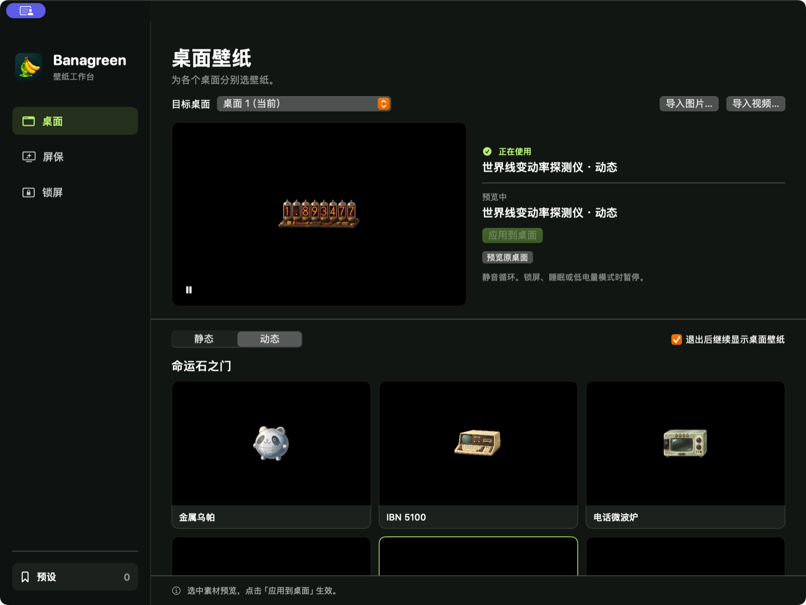
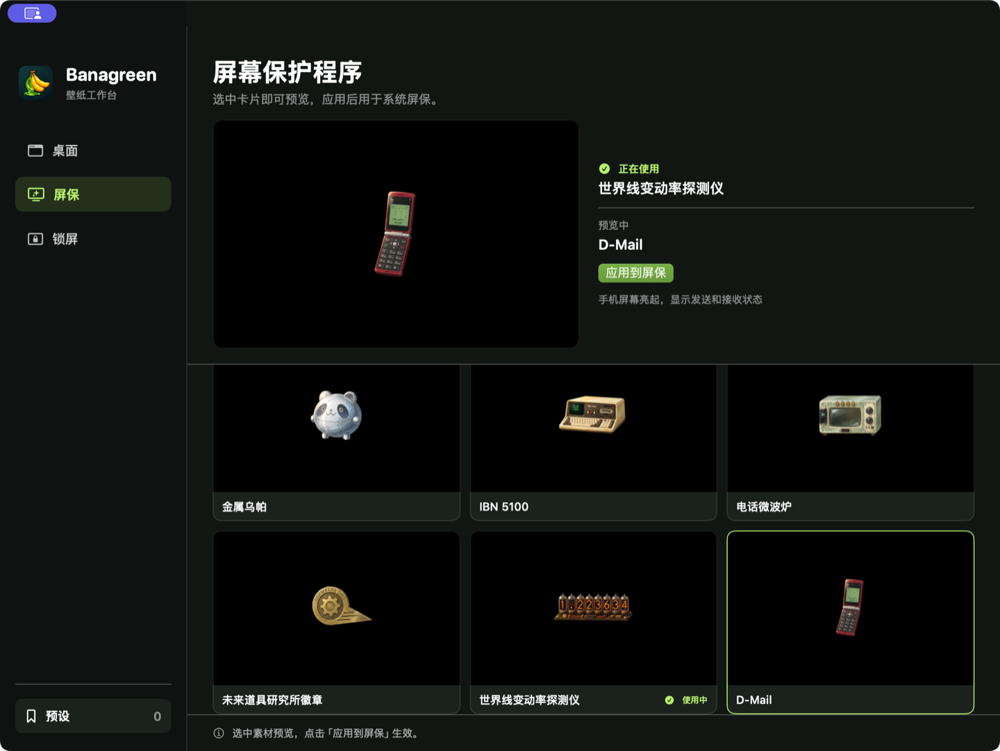
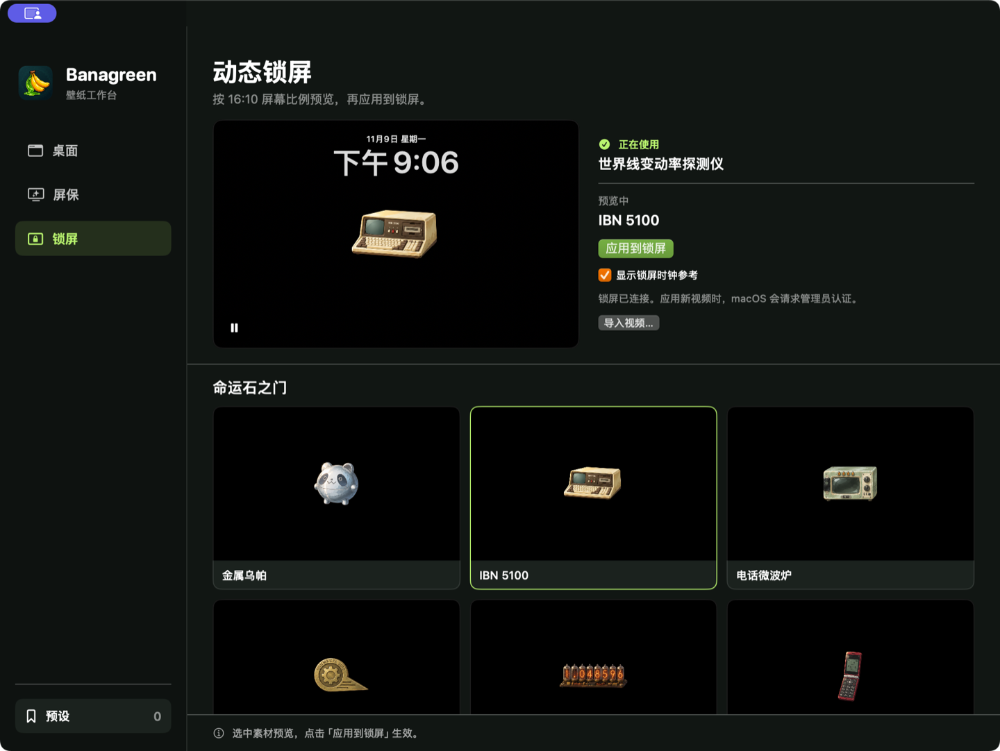

# Banagreen

Banagreen 是一款 macOS 壁纸工作台，支持分别管理桌面壁纸、屏幕保护程序和动态锁屏。内置六款《命运石之门》主题素材，也可以导入自己的图片和视频。

**[下载 Banagreen v1.4.0（Apple 芯片版 ZIP）](https://github.com/C0-rrect/Banagreen/releases/download/v1.4.0/Banagreen-v1.4.0-macos-arm64.zip)** · [版本说明](https://github.com/C0-rrect/Banagreen/releases/tag/v1.4.0) · [SHA-256 校验文件](https://github.com/C0-rrect/Banagreen/releases/download/v1.4.0/Banagreen-v1.4.0-macos-arm64.zip.sha256)

## 功能

- **桌面壁纸** · 为每个 macOS 桌面（空间）分别选用静态图片或动态视频。动态视频静音循环，可在退出主界面后继续播放。
- **屏幕保护程序** · 从六款黑底主题屏保中选择，也可切换到 macOS 自带的屏保。
- **动态锁屏** · 使用带时钟参考的 16:10 预览，从内置素材或本地视频中选择锁屏动画。
- **素材与预设** · 导入素材会进入历史记录，可逐项删除。可保存预设以便切换。三个页面均区分「正在使用」和「预览中」，点按「应用」才会切换。

内置主题包括金属乌帕、IBN 5100、电话微波炉、未来道具研究所徽章、世界线变动率探测仪和 D-Mail。

## 界面截图

### 桌面

### 屏保

### 锁屏

## 下载与安装

**系统要求** · Apple 芯片（arm64），macOS 15.0 或更高版本。自定义动态锁屏目前仅支持 **macOS Sequoia 15**。

1. 从 [GitHub Releases](https://github.com/C0-rrect/Banagreen/releases/tag/v1.4.0) 下载 `Banagreen-v1.4.0-macos-arm64.zip`。
2. 双击 ZIP 解压，将 `Banagreen.app` 拖入「应用程序」文件夹。
3. 从「应用程序」打开 Banagreen，进入「桌面」「屏保」或「锁屏」选择并预览素材。

此版本尚未经 Apple 公证。若首次启动被 macOS 拦截，请先确认下载来源可信且文件完整，再在尝试打开后前往「系统设置 → 隐私与安全性」，为 Banagreen 选择「仍要打开」。[Apple 官方说明](https://support.apple.com/zh-cn/102445)

### 首次启用动态锁屏

1. 在 macOS 的「系统设置 → 屏幕保护程序」下载并选中「索诺马地平线」，开启「显示为墙纸」。
2. 在 Banagreen 的「屏保」页应用一个独立屏保。
3. 在「锁屏」页预览内置动画或导入的视频，点按「应用到锁屏」，按 macOS 提示完成管理员认证。

Banagreen 首次替换时会备份一份苹果航拍原片。后续切换沿用这份备份，可在「锁屏」页选择「恢复苹果航拍原片」。
